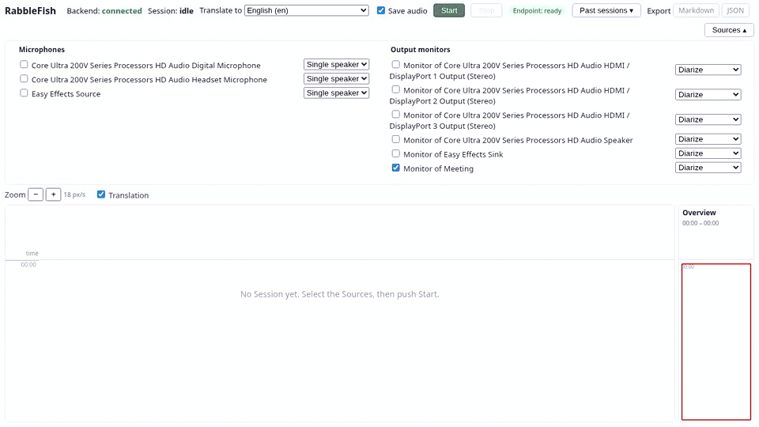
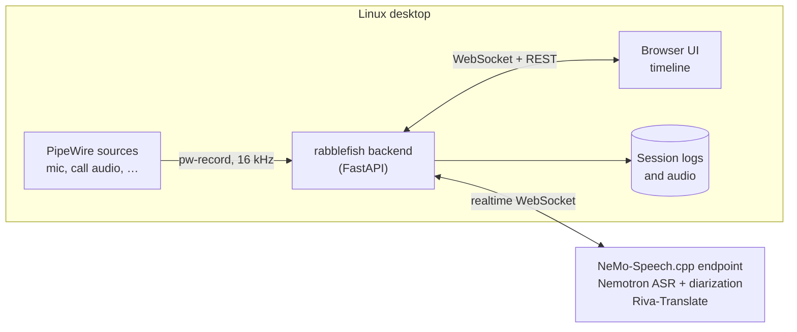

<div align="center">

# RabbleFish

**Live, multi-speaker transcription and translation of your Linux desktop audio, with local models.**

[](LICENSE)


[Overview](#overview) · [Features](#features) · [Get started](#get-started) · [Usage](#usage) · [Endpoint](#endpoint) · [Development](#development)



<sub>A real Session, sped up 3×: an English meeting (AMI corpus), then French read speech (Multilingual LibriSpeech), transcribed, diarized and translated on a laptop's Intel Arc iGPU. Audio CC BY 4.0, see <a href="NOTICE">NOTICE</a>.</sub>

</div>

## Overview

RabbleFish captures one or more PipeWire sources (your microphone, the audio of a call, any output device) and shows what each person says as it is spoken, on a timeline with **one column per speaker**. It detects language switches, can translate each segment into one target language, saves the whole session as it goes, and exports it to Markdown or JSON.

The app never runs a model itself. It streams the audio to a **NeMo-Speech.cpp endpoint**, which runs NVIDIA's Nemotron models for transcription and diarization and Riva-Translate for translation. By default the endpoint runs on the same machine. To use a GPU elsewhere on your network, point the app at another URL.



## Features

- **One column per speaker**, aligned on a shared time axis, with long silences folded and an overview of the whole session.
- **Several sources at once**, each in *single speaker* mode (your headset) or *diarize* mode (a call or a room), with up to 8 speakers per diarized source.
- **Live partial text** while someone speaks, then final segments with speaker, timing and language about 1 s after each utterance.
- **Language switches** (for example English ↔ French), detected per segment and marked in the timeline.
- **Translation** of each finalized segment into one target language (English and 36 others).
- **Rename and merge speakers**, during or after the session.
- **Continuous saving** of every event and of the raw audio. A crash loses nothing, and the session reopens as *interrupted*.
- **Export** to a readable Markdown transcript or a structured JSON document.
- **Warnings** for a muted or silent source, and a live status of the endpoint.
- **Local first**: the models run on your GPU (Vulkan, CUDA) or CPU, and no audio leaves your network.

## Get started

### Prerequisites

- Linux with **PipeWire** (`pw-dump`, `pw-record`)
- [**uv**](https://docs.astral.sh/uv/), **Node.js** and [**pnpm**](https://pnpm.io/) (the install builds the UI)
- For the endpoint: `curl`, `git`, `tar`, `sha256sum`, and a GPU with a Vulkan driver, an NVIDIA GPU with compute capability 7.5 or newer, or a fast CPU

### 1. Set up the endpoint

```sh
scripts/setup-endpoint.sh --backend vulkan   # or: cuda, cpu
```

The script downloads the NeMo-Speech.cpp server and the models, converts the translation model once, checks every file, and prints the exact `nemo-speech serve` command to run. It needs about 5.3 GB of disk, plus about 11 GB more during the conversion. You can run it again at any time: it skips the work that is done.

### 2. Install and start the app

```sh
uv tool install ./backend    # puts the `rabblefish` command in ~/.local/bin
rabblefish serve                    # then open http://127.0.0.1:8000
```

### 3. Run a session

1. Open **Sources**. Select your microphone (*single speaker*) and the monitor of the output that carries the call (*diarize*).
2. Choose a language in **Translate to**, and set **Save audio** on or off.
3. Press **Start**. To rename a speaker, click its column name. Press **Stop** when you are done.

> [!TIP]
> The **Endpoint** chip shows whether the server is ready. The app starts without it and checks again every 30 s, so you can start the endpoint after the app.

## Usage

### Command line

| Command | What it does |
| --- | --- |
| `rabblefish serve` | Start the backend and the web UI (`--host`, `--port`) |
| `rabblefish sessions list` | List the saved sessions: ID, date, length, state, speakers |
| `rabblefish export <id> --format md\|json [-o FILE]` | Export one session to Markdown or JSON |
| `rabblefish config` | Show each effective setting and where it comes from |

The UI also lists the past sessions. You can reopen one read-only, rename and merge its speakers, export it, or delete it.

### Settings

The app works with no settings. To change them, create `~/.config/rabblefish/config.toml`:

```toml
asr_endpoint_url = "ws://127.0.0.1:8080"   # the NeMo-Speech.cpp endpoint
# translation_endpoint_url = "http://gpu-box:8080"   # default: the same server
detect_languages = ["en", "fr"]
default_target_language = "en"
# data_dir = "~/.local/share/rabblefish"
host = "127.0.0.1"
port = 8000
```

Each key has an `RABBLEFISH_*` environment variable that overrides the file. The full table is in [`backend/README.md`](backend/README.md#settings).

> [!IMPORTANT]
> The app has **no login**. Keep `host = "127.0.0.1"` unless you trust everyone on the network: anyone who can reach the port can read the transcripts and start a session.

The sessions are saved under `~/.local/share/rabblefish/sessions/`, one folder per session, with an `events.jsonl` log and the raw audio (about 115 MB per hour per source). Nothing is deleted automatically.

## Endpoint

Every endpoint runs the same stack ([ADR-0001](docs/adr/0001-endpoint-only-app-built-new.md)): NeMo-Speech.cpp with Nemotron 3.5 ASR Streaming 0.6B, Nemotron 3 Diarization and Riva-Translate-4B. The server needs `--asr.endpointing.enable=true --asr.batching.enabled=false`, and `--threads` at least equal to the number of sources. The setup script prints these flags for you.

Measured capacity in real time, with diarization:

| Hardware | Sources | Notes |
| --- | --- | --- |
| Intel Core Ultra 7 258V, Arc 140V (Vulkan) | 3 | Translation keeps up with 1 source |
| NVIDIA GTX 1080 Ti (CUDA, source build for `sm_61`) | 8 | The prebuilt CUDA archive needs compute capability 7.5 or newer |
| NVIDIA RTX 5080 (CUDA) | 8 | GPU about half busy |

> [!NOTE]
> To use a GPU machine on your network, run the same setup script there and set `asr_endpoint_url` to its address. [`docs/endpoint.md`](docs/endpoint.md) covers remote use and the optional systemd user units.

## Development

```sh
pnpm install
pnpm dev      # backend on :8000 and Vite on http://127.0.0.1:5173
pnpm test     # backend tests, frontend type check and unit tests
pnpm lint     # ruff
pnpm build    # build the UI into frontend/dist
```

To replay a recorded session in the timeline without a backend, open http://127.0.0.1:5173/?demo (add `&speed=4` to play it faster).

| Folder | Contents |
| --- | --- |
| `backend/` | FastAPI app and the `rabblefish` CLI (Python, `uv`) |
| `frontend/` | Timeline UI (React, Vite, TypeScript) |
| `scripts/` | Endpoint setup script and systemd user unit templates |
| `docs/` | [Architecture decisions](docs/adr/) and the [endpoint guide](docs/endpoint.md) |

## Learn more

- [`GLOSSARY.md`](GLOSSARY.md): the domain terms used in the code and the UI (Session, Source, Speaker, Segment, …)
- [The project map](https://github.com/gdevenyi/RabbleFish/issues/1): every design decision, with the benchmarks behind each one
- [`backend/README.md`](backend/README.md): the API, the events and the export formats
